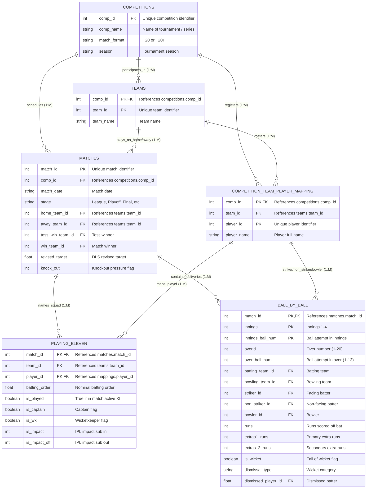

# SupeRR Selector Season 2 - Relational Schema & Join Architecture

This document describes the relational architecture of the SupeRR Selector Season 2 data pack, detailing primary and foreign key constraints, join cardinalities, referential integrity results, and pitfalls to avoid during data transformation.

---

## 1. Entity-Relationship Diagram



---

## 2. Table-by-Table Key & Cardinality Matrix

| Parent Table | Child Table | Foreign Key Fields | Cardinality | Referential Integrity | Potential Join Hazard |
| :--- | :--- | :--- | :--- | :--- | :--- |
| **competitions** | **teams** | `comp_id` | 1 : Many | 100% matched (0 orphans) | Safe inner/left join |
| **competitions** | **matches** | `comp_id` | 1 : Many | 100% matched (0 orphans) | Safe inner/left join; 3 comps have 0 matches |
| **competitions** | **mappings** | `comp_id` | 1 : Many | 100% matched (0 orphans) | Safe inner/left join |
| **teams** | **matches** | `team_id` -> `home_team_id`, `away_team_id` | 1 : Many | 100% matched (0 orphans) | Must alias team joins (`home_team` vs `away_team`) |
| **matches** | **ball_by_ball** | `match_id` | 1 : Many | 100% matched (0 orphans) | Safe. Note: 16 matches have 0 deliveries (abandoned) |
| **matches** | **playing_eleven** | `match_id` | 1 : Many | 100% matched (0 orphans) | Safe from match side; 3 matches have 0 p11 rows |
| **mappings** | **playing_eleven** | `player_id` | 1 : Many | 100% matched (0 orphans) | Safe |
| **mappings** | **ball_by_ball** | `player_id` -> `striker_id`, `bowler_id` | 1 : Many | 100% matched (0 orphans) | Safe. Every ball player exists in mappings |
| **playing_eleven** | **ball_by_ball** | `match_id`, `player_id` | Many : Many* | 2 players missing from p11 in match 37087 | **HIGH RISK**: Will multiply rows if not deduplicated! |

---

## 3. Critical Join Pitfalls & Safety Rules

### Hazard 1: Row Multiplication when Joining `playing_eleven`
- **Issue**: `playing_eleven.csv` contains multiple records for the same `(match_id, player_id)` in matches `13613`, `21176`, and `28962` (differing nominal batting orders).
- **Consequence**: An unconstrained SQL or pandas join:
  ```python
  # DANGEROUS: Will duplicate deliveries for those 3 matches!
  df = bbb.merge(p11, left_on=["match_id", "striker_id"], right_on=["match_id", "player_id"])
  ```
- **Safe Practice**: Always deduplicate `playing_eleven` prior to joining:
  ```python
  # SAFE: Deduplicate squad table first
  p11_clean = p11.sort_values("batting_order").drop_duplicates(subset=["match_id", "player_id"], keep="first")
  df = bbb.merge(p11_clean, left_on=["match_id", "striker_id"], right_on=["match_id", "player_id"], how="left")
  ```

### Hazard 2: Joining on `player_name` instead of `player_id`
- **Issue**: Exactly 7 distinct player names belong to 2 different players each (e.g., two distinct cricketers named `Abdul Samad`, two named `Rashid Khan`, two named `Haider Ali`).
- **Consequence**: Grouping by or joining on `player_name` merges statistics of two completely separate professional players.
- **Safe Practice**: Always aggregate and join exclusively on `player_id`. Only attach `player_name` at final reporting time.

### Hazard 3: Double-Counting Runs from Extras
- **Issue**: Total runs on a delivery is NOT simply `runs + extras1_runs`.
- **Consequence**: There are 36 compound delivery events where `extras_2_runs` is positive (No Ball + Byes/Legbyes/Boundary).
- **Safe Practice**: Total team runs scored on delivery:
  $$\text{Total Runs} = \text{runs} + \text{extras1\_runs} + \text{extras\_2\_runs}$$
- Bowler runs conceded:
  $$\text{Bowler Runs Conceded} = \text{runs} + \text{extras1\_runs} \quad (\text{only when extras\_type} \in \{\text{'wide'}, \text{'Overstep'}, \text{'other'}\})$$
  *(Byes and leg-byes are not charged to the bowler).*

### Hazard 4: Super Overs distorting Cumulative Inning Totals
- **Issue**: 6 matches contain innings 3 and 4 (Super Overs).
- **Consequence**: If an analysis treats `innings >= 2` as the regular chase, Super Overs will falsely appear as short chases or distort run rates.
- **Safe Practice**: Scope regular chase analysis strictly to `innings == 2`. Analyze Super Overs separately as standalone super-pressure events.
